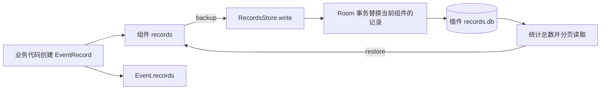

# Event 持久化

本文说明当前仓库中 Event 相关记录的持久化实现，面向插件开发者和宿主维护者。实现集中在 `core` 的 `widgets/event` 包，默认通过 Room 和 SQLite 保存 Provider、Dispatcher 的 `records`。

组件持有的 `List<EventRecord>` 由 `backup()` 保存到插件的 `records.db`。`update(event)` 将完整 Event 的 `payload`、`metadata`、`records` 和处理状态保存到宿主 `Events/events.db`；恢复组件记录不会重新执行事件。

### 更新处理记录与事件快照

`Widget.update(event: Event)` 的默认实现在 `BaseWidget`。业务先通过受保护的 `record(...)` 创建明确的分发决策或处理结果，追加到事件履历和当前组件日志，再调用 `update(event)` 保存。`update` 还会将事件履历中属于当前组件、当前事件的记录按记录 ID 去重补入组件日志，不会触发 `receive`、`dispatch` 或 `emit`。

Dispatcher 在调用目标前记录决策，调用返回后更新事件快照：

```kotlin
record(event, DispatchType.HANDLE, provider)
provider.receive(event)
update(event)
```

Provider 完成处理后更新；返回同一个事件时，必须先保存结果再调用 Dispatcher 的回调：

```kotlin
record(event, Result.DO_BACK, "处理完成，继续分发")
update(event)
checkNotNull(emit)(event)
```

示例插件的分发异常路径也会尝试保存已有记录，并保留原异常。取消不会被转换成成功结果。Echo 产生新回复事件，回复与原输入使用各自的 ID 和履历。

Root 从最新 Provider 的 `BACK/DO_BACK` 记录识别回传者；同一事件在当前分发链中最多交给每个子 Dispatcher 一次，避免同步回传产生重复处理或循环。最外层调用结束后清理本次目标集合，允许之后再次分发同一事件。

事件状态依据该事件的最后一条记录：`Handle(DONE/END)` 为 `COMPLETED`；分发、`BACK/DO_BACK` 或空履历为 `PROCESSING`。Dispatcher 仅再次调用 `update` 不会改变已经完成的状态；追加新的分发决策则表示进入下一轮处理。相同事件 ID 在数据库事务中覆盖快照，保留 `Event.records` 的追加顺序。

宿主事件库延迟打开，由所有组件共享，`Runtime.stop()` 在组件停止后关闭，启动失败的清理路径也会关闭。直接使用组件的宿主须在停止组件后调用 `EventStore.closeRuntime()`；运行目录在句柄存活期间须保持不变。`update` 不会立即保存插件的组件日志，插件日志仍由 `backup()` 保存。事件与组件的列表修改须按现有契约串行执行。

## 1. 数据模型与记录责任

### Event 与 EventRecord

| 对象或字段 | 含义 | 默认持久化行为 |
| --- | --- | --- |
| `Event.id` | 当前事件的 UUID | 作为宿主事件库主键；组件日志保存对应的 `eventId`。 |
| `Event.metadata` | 来源 `providerId`、创建时间 `createdAt` | `update(event)` 写入宿主事件库。 |
| `Event.payload` | 文本或二进制内容 | `update(event)` 写入宿主事件库。 |
| `Event.records` | 当前事件流转过程中的记录列表 | `update(event)` 按列表顺序保存完整快照。 |
| `Widget.records` | 当前 Provider 或 Dispatcher 的记录列表 | 基类的 `backup()` 保存，`restore()` 恢复。 |

`EventRecord` 描述一次调度决策或处理结果，通过 ID 关联事件和组件，不引用完整 Event：

| 字段 | 类型 | 含义 |
| --- | --- | --- |
| `id` | `Uuid` | 单条记录标识，默认随机生成。 |
| `eventId` | `Uuid` | 关联的事件 ID。 |
| `occurredAt` | `Instant` | 记录发生时间，默认当前时间。 |
| `actor` | `ComponentRef` | 实际作出决策或完成处理的组件。 |
| `action` | `Action` | 调度决策或处理结果。 |

`ComponentRef` 包含组件 `id` 和 `kind`，其中 `kind` 为 `PROVIDER` 或 `DISPATCHER`。

### Action

| 类型 | 字段 | 含义 |
| --- | --- | --- |
| `Action.Dispatch` | `type`、`target`、可选 `reason` | 准备将事件交给目标组件的决策，不代表已经送达或处理成功。 |
| `Action.Handle` | `result`、可选 `detail` | 组件处理事件后的结果和补充说明。 |

`DispatchType` 有三种取值：`HANDLE`（交给 Provider）、`DISPATCH`（交给下级 Dispatcher）、`FEED_UP`（上报上级 Dispatcher）。

`Result` 有四种取值：`DONE`（完成并终结）、`END`（无效并终结）、`BACK`（出错后反馈）、`DO_BACK`（完成后返回 Dispatcher 继续分发）。这些枚举描述记录语义，records 存储层不会根据它们执行调度。

### 谁负责生成记录

核心基类提供 `record(...)`、`update(event)` 与备份、恢复；业务在知道目标或结果的位置显式调用。Echo、CMD 和 Root 插件已在 Provider 处理和向目标分发时接入记录与更新。

需要追踪事件时，由业务代码创建记录，并按需要将同一条记录追加到两处：

- `event.records`：保留当前事件的流转履历，要求 `record.eventId == event.id`。
- `records`：保留当前组件的处理日志，要求 `record.actor` 指向当前组件。

`record(...)` 同时追加两份列表，`update(event)` 补入属于当前组件的事件记录。只调用组件 `backup()` 不会保存完整 Event；完整事件快照由 `update(event)` 保存。直接创建记录时，调用方负责保证关联关系正确。

## 2. 存储位置与隔离

JVM 宿主中的文件布局如下：

```text
<运行目录>/
└── Plugins/
    └── <pluginId>/
        ├── versions/<version>/         # 插件安装文件
        └── Data/
            └── databases/
                └── records.db          # 组件记录数据库
```

数据库名称固定为 `records.db`，由 `RecordsStore` 通过 `context.databases.open("records.db", RecordsDatabaseFactory)` 延迟打开。宿主创建目录，并在同一个插件 Context 内复用数据库实例。

数据隔离分为两层：

1. **插件隔离**：不同 `pluginId` 使用不同的数据库文件；同一插件的不同安装版本共享该插件的 `Data`。
2. **组件隔离**：数据库按 `component_id + component_kind` 区分记录，同一个 UUID 的 Provider 和 Dispatcher 可以各自保存记录。

这里的 `component_id` 是被备份组件的 ID，`actor_id` 是记录中的执行者 ID，二者分别存储。应由业务代码保证记录的执行者与所属组件一致。

组件 ID 必须稳定，才能在重建实例、重新加载或升级后恢复原记录。`BaseDispatcher.id` 默认使用 `Uuid.random()`，插件应显式覆盖为稳定 UUID。同一个插件内，同类型的组件也不能共用持久化 ID，否则它们的备份会替换同一组记录。

组件日志使用上述插件专属数据库；完整 Event 快照由 `EventStore` 写入 `<运行目录>/Events/events.db`，与插件的 `records.db` 独立。

## 3. Room 表结构

数据库为 `RecordsDatabase`，当前 schema 版本为 **1**，业务表名为 `widget_records`。表中所有业务列均使用 SQLite `TEXT`，UUID 和时间由 `toString()` 转为字符串。

| 列 | 可空 | 来源或用途 |
| --- | --- | --- |
| `component_id` | 否 | 被备份组件的 UUID。 |
| `component_kind` | 否 | 被备份组件类型：`PROVIDER` / `DISPATCHER`。 |
| `record_id` | 否 | `EventRecord.id`。 |
| `event_id` | 否 | `EventRecord.eventId`。 |
| `occurred_at` | 否 | `EventRecord.occurredAt` 的时间字符串。 |
| `actor_id` | 否 | `EventRecord.actor.id`。 |
| `actor_kind` | 否 | `EventRecord.actor.kind` 的枚举名。 |
| `action_type` | 否 | 小写字符串 `dispatch` / `handle`。 |
| `dispatch_type` | 是 | Dispatch 的 `type` 枚举名。 |
| `target_id` | 是 | Dispatch 的目标组件 UUID。 |
| `target_kind` | 是 | Dispatch 的目标组件类型。 |
| `reason` | 是 | Dispatch 的原因。 |
| `result` | 是 | Handle 的结果枚举名。 |
| `detail` | 是 | Handle 的补充说明。 |

复合主键为 `(component_id, component_kind, record_id)`。同一组件内重复的记录 ID 使用 `OnConflictStrategy.REPLACE`，因此记录 ID 应保持唯一。

表有两个索引：

- `(component_id, component_kind, occurred_at, record_id)`：支持按组件筛选及排序。
- `(event_id)`：为按事件关联记录提供索引；当前 `RecordsStore` 没有按事件 ID 查询的接口。

`Action.Dispatch` 写入调度相关列，处理结果列为空；`Action.Handle` 写入结果相关列，调度相关列为空。恢复时根据 `action_type` 重建对应的 Action。

schema 导出文件为 [RecordsDatabase/1.json](../core/schemas/com.eva_cli.core.widgets.event.RecordsDatabase/1.json)。当前没有注册数据库迁移或破坏性迁移回退；后续修改表结构时，需要由核心维护 schema 版本和迁移策略。

## 4. 保存、恢复与分页



### 保存：按组件整体替换

`BaseProvider.backup()` 和 `BaseDispatcher.backup()` 调用 `RecordsStore.write()`，将当前组件的整个 `records` 列表转换为 `RecordEntity`。DAO 在一个事务中：

1. 删除当前 `component_id + component_kind` 的旧记录。
2. 当前列表非空时，插入新的完整列表。

事务保证单个组件的删除与插入一起提交或回滚。不同组件以及整棵调度树的备份没有共同事务，某个组件失败时，不会撤销此前其他组件已经完成的保存。

保存不是逐条追加，每次备份仍需转换并写入该组件的完整列表。修改内存中的 `records` 不会立即落盘，需要等待生命周期备份或主动调用 `backup()`。

### 恢复：读取持久化列表

`restore()` 用读取结果替换组件当前的 `records`，不会与已有内存列表合并。没有对应记录时恢复为空列表，首次查询由 Room 初始化数据库及表。

读取顺序由 SQL 定义：

```sql
SELECT * FROM widget_records
WHERE component_id = :componentId
  AND component_kind = :componentKind
ORDER BY occurred_at ASC, record_id ASC
LIMIT :limit OFFSET :offset;
```

**恢复不会保留保存前列表的追加顺序**，相同时间字符串下按记录 UUID 字符串排序。`occurred_at` 是 TEXT，数据库按字符串比较；时间字符串精度不一致时，也不能据此保证严格的 `Instant` 时间先后。

完整读取先执行 `COUNT(*)`，再以默认每页 **512 条**进行 `LIMIT/OFFSET` 查询，最后组装为一个 `List<EventRecord>`。总数超过 `Int.MAX_VALUE` 时会拒绝完整读取。分页减少单次查询结果规模，但公开的 `records` 仍会将全部记录装入内存。

内部 `RecordsStore.count()` 返回 `Long`；`RecordsStore.page()` 支持自定义 `limit`、`offset`，要求 `limit > 0`、`offset >= 0`，超出范围返回空列表。**`RecordsStore` 为 `internal`，这些不是插件可调用的公开 API**；插件使用组件的 `records`、`backup()` 和 `restore()`。

统计总数与多页读取没有共同的读事务。读取期间若有其他任务替换同一组件的记录，结果可能来自不同保存状态，因此备份、恢复与列表更新应串行执行。

## 5. 生命周期与资源释放

默认调度树生命周期由 `BaseDispatcher` 组织：

| 入口 | 调用顺序 |
| --- | --- |
| `start()` | 恢复当前 Dispatcher → 扫描子 Dispatcher 和 Provider → 对每个 Provider 执行恢复、绑定 `emit`、启动 → 绑定并启动各子 Dispatcher。 |
| `stop()` | 备份当前 Dispatcher → 对每个 Provider 执行备份、停止 → 停止各子 Dispatcher。 |
| `backupTree()` | 备份当前 Dispatcher → 备份当前 Provider → 递归备份子 Dispatcher 树。 |
| `restoreTree()` | 恢复当前 Dispatcher → 恢复当前 Provider → 递归恢复子 Dispatcher 树。 |

子 Dispatcher 的启动和停止会按同样流程递归处理。`backupTree()`、`restoreTree()` 仅处理现有组件映射，不会扫描或启动组件。

`BaseProvider` 只实现 `backup()`、`restore()`；单独调用 Provider 的 `start()`、`stop()` 不会自动持久化记录。脱离默认 Dispatcher 树使用 Provider 时，宿主需要显式安排恢复和备份。

运行时主路径为：

```text
Eva.start()
  → Runtime.start() → 加载插件 → 根 Dispatcher.start() → 递归恢复与启动

Eva.stop()
  → Runtime.stop() → 根 Dispatcher.stop() → 递归备份与停止
  → 释放插件 Context、数据库和加载器
```

数据库句柄由宿主 Context 管理。组件停止时应释放自己的任务，数据库在插件卸载时由宿主统一关闭，插件不应自行关闭共享的 `records.db`。同名数据库只允许使用同一个 factory 对象，插件自己的数据库应使用其他名称。

`PlugManager.unloadPlugin()` 只释放 Context 和加载器，**不会调用组件 `stop()` 或 `backup()`**。手动卸载前应先停止组件、完成备份并注销组件。Context 关闭后不可继续调用其数据库接口。

默认 `BaseDispatcher.stop()` 在停止 Provider 前执行备份。若 Provider 在后台持续产生记录，宿主与插件需要安排同步，避免备份后又追加记录。生命周期操作失败会向上传播，不能把一次失败的树停止或备份视为所有组件都已保存。

`Runtime.stop()` 即使遇到树停止或备份异常，也会继续释放全部插件的 Context 和数据库。因此不能在停止失败后直接对旧组件调用 `backup()` 重试；后续数据库操作需要重新加载插件并使用新实例。

## 6. 插件接入示例

宿主应在首次生命周期调用前通过 `attach(context)` 绑定插件 Context；组件构造阶段不能访问 `context`。

以下 Provider 使用稳定 ID，在处理文本事件后创建记录，同时更新事件履历和组件日志，并主动调用 `backup()` 保存。示例要求宿主串行调用 `receive()` 和生命周期方法。

```kotlin
import com.eva_cli.core.widgets.event.Action
import com.eva_cli.core.widgets.event.ComponentRef
import com.eva_cli.core.widgets.event.Event
import com.eva_cli.core.widgets.event.EventRecord
import com.eva_cli.core.widgets.event.Result
import com.eva_cli.core.widgets.provider.PluginProvider
import com.eva_cli.core.widgets.provider.Provider
import kotlin.uuid.Uuid

class RecordedProvider : PluginProvider() {
    override val id = Uuid.parse("66666666-6666-4666-8666-666666666666")
    override val name = "Recorded Provider"
    override val desc = "Records text handling results"
    override val topic = "/Recorded"
    override var enable = true
    override var status = Provider.Status.STOP
    override var records: List<EventRecord> = emptyList()
    override var emit: (suspend (Event) -> Unit)? = null

    override suspend fun start() {
        status = Provider.Status.IDLE
    }

    override suspend fun stop() {
        status = Provider.Status.STOP
    }

    override suspend fun receive(event: Event) {
        if (!enable || status == Provider.Status.STOP) return
        if (event.payload !is Event.Payload.Text) return

        // 在这里执行实际业务；成功后创建处理结果记录。
        val record = EventRecord(
            eventId = event.id,
            actor = ComponentRef(id, ComponentRef.Kind.PROVIDER),
            action = Action.Handle(Result.DONE, detail = "文本事件处理完成"),
        )
        event.records = event.records + record
        records = records + record
        backup()
    }
}
```

默认 Dispatcher 启动流程会在此 Provider 的 `start()` 前调用 `restore()`，停止前调用 `backup()`。示例中的额外 `backup()` 缩短了仅存于内存的时间，但每次仍是全量替换；记录量较大时，可以由业务安排批量保存，并接受两次保存之间的丢失窗口。

若插件重写 `backup()` 或 `restore()` 保存其他业务数据，应调用 `super.backup()`、`super.restore()` 保留默认 records 持久化。重写 Dispatcher 的 `start()`、`stop()` 时，也应保留或显式复现默认树生命周期。

仅调用 `super.start()`、`super.stop()` 不会给独立 Provider 增加自动备份与恢复；其默认启停方法为空。

## 7. 清理、升级与文件备份

### 清理当前组件的记录

在串行执行的组件方法中清空列表，再备份即可删除当前组件的数据库记录：

```kotlin
records = emptyList()
backup()
```

也可以先筛选需要保留的记录，再调用 `backup()`。当前没有自动过期、容量限制或定时清理策略；删除组件或更换组件 ID 也不会自动清理旧 ID 的记录。

### 升级与卸载

重新加载和升级后，只要保留相同的运行目录、插件 ID、组件 ID 和组件类型，就能访问原数据。修改其中任意身份字段会读取另一份记录空间。

`unloadPlugin()` 不删除运行数据；`uninstallPlugin(id, version)` 只删除指定版本的安装目录，保留 `Data`、`Cache` 和其他版本。因此卸载安装版本不会清空 `records.db`。

### 组件备份与插件快照

| 操作 | 用途 |
| --- | --- |
| 组件 `backup()` / Dispatcher `backupTree()` | 将内存中的 records 写入数据库。 |
| `PlugManager.backup(includeRuntimeData = false)` | 生成插件安装快照，不包含 records 数据库。 |
| `PlugManager.backup(includeRuntimeData = true)` | 将有效已安装插件的版本目录和对应 `Data` 备份到 `Backup/plugins.zip`，包含已保存的 records 数据库，排除 `Cache`。 |
| `PlugManager.restore()` | 恢复文件快照；包含运行数据的快照会替换快照内插件的 `Data`，随后组件仍需通过 `restore()` 加载记录。 |

备份或恢复运行数据前，相关插件必须先停止并卸载已加载实例，以释放数据库文件。文件快照不会把内存中的 records 自动写入数据库。仅剩 `Data`、没有有效安装版本的插件，不在安装快照的扫描覆盖范围内。

含运行数据的快照若没有某个快照内插件的 `Data`，恢复时会将该插件当前的 `Data` 清空；快照外插件的 `Data` 和所有 `Cache` 保留。

## 8. 边界与常见问题

| 现象或需求 | 检查点 |
| --- | --- |
| 处理过事件，恢复后却没有记录 | 是否创建了 `EventRecord`、追加到组件 `records`，并成功调用过 `backup()`。 |
| 重启后读不到旧记录 | 检查运行目录、插件 ID、组件 ID、组件类型；尤其检查随机生成的 Dispatcher ID。 |
| 只有事件履历，没有持久化记录 | 是否调用 `update(event)` 保存宿主快照，以及 `backup()` 保存组件日志。 |
| 恢复后顺序变化 | SQL 按 `occurred_at`、`record_id` 的字符串值排序，没有保存追加序号。 |
| 一次备份后数据量变少 | 保存完整替换当前组件快照；检查内存列表是否被清空、截断，或存在重复记录 ID。 |
| 卸载后数据库访问失败 | Context 已关闭；应重新加载插件并使用新实例及其 Context。 |
| 出现非法 UUID、时间、枚举或缺失字段 | 恢复会抛出异常，不会跳过坏记录或将错误当作空列表。 |
| 需要在进程异常退出后保留最近处理记录 | 需要主动安排更频繁的备份；仅靠正常停止时保存不能覆盖异常退出。 |
| 需要完整 Event 归档、重放或可靠投递 | `EventStore` 已保存完整快照与状态；重放和可靠投递仍须由宿主安排，读库不会自动执行事件。 |
| 需要查询跨组件或跨插件的事件履历 | 当前没有对应公开 API；插件数据库也按插件隔离。 |

`List<EventRecord>` 的只读接口不保证底层集合不可变，`records = records + record` 也不是原子操作。并发处理时，需要同步列表更新与保存/恢复，避免丢失追加或读取混合状态。

## 9. 平台、实现与验证

核心已提供 JVM、Android、iOS 的 Room 数据库构造实现，统一使用 `BundledSQLiteDriver`。JVM、Android 查询协程使用 `Dispatchers.IO`，iOS 使用 `Dispatchers.Default`。当前插件运行时加载和宿主 Context 的完整实现以 JVM 为准，Android/iOS 的数据库构造代码不代表插件加载流程已经可用。

构建通过 KSP 为各 target 生成 Room 代码，schema 导出至 `core/schemas`。依赖版本与 target 配置以 [core/build.gradle.kts](../core/build.gradle.kts) 和 [libs.versions.toml](../gradle/libs.versions.toml) 为准。

主要源码入口：

| 文件 | 职责 |
| --- | --- |
| [Event.kt](../core/src/commonMain/kotlin/com/eva_cli/core/widgets/event/Event.kt) / [EventRecord.kt](../core/src/commonMain/kotlin/com/eva_cli/core/widgets/event/EventRecord.kt) | 事件、记录及动作模型。 |
| [RecordsStore.kt](../core/src/commonMain/kotlin/com/eva_cli/core/widgets/event/RecordsStore.kt) | 数据库打开、领域转换、写入、完整读取和内部分页。 |
| [RecordEntity.kt](../core/src/commonMain/kotlin/com/eva_cli/core/widgets/event/RecordEntity.kt) / [RecordsDao.kt](../core/src/commonMain/kotlin/com/eva_cli/core/widgets/event/RecordsDao.kt) / [RecordsDatabase.kt](../core/src/commonMain/kotlin/com/eva_cli/core/widgets/event/RecordsDatabase.kt) | 表结构、SQL、事务和数据库版本。 |
| [BaseProvider.kt](../core/src/commonMain/kotlin/com/eva_cli/core/widgets/provider/BaseProvider.kt) / [BaseDispatcher.kt](../core/src/commonMain/kotlin/com/eva_cli/core/widgets/dispatcher/BaseDispatcher.kt) | 默认备份、恢复和调度树生命周期。 |
| [JvmWidgetContext.kt](../core/src/jvmMain/kotlin/com/eva_cli/core/widgets/context/JvmWidgetContext.kt) | JVM 插件路径隔离、数据库复用与关闭。 |
| [PlugManager.kt](../core/src/commonMain/kotlin/com/eva_cli/core/widgets/plug/PlugManager.kt) | 插件加载、卸载、安装快照及运行数据的生命周期约定。 |

现有 [RecordsStoreJvmTest.kt](../core/src/jvmTest/kotlin/com/eva_cli/core/widgets/RecordsStoreJvmTest.kt) 覆盖：

- Provider 与 Dispatcher 使用相同组件 UUID 时的记录隔离，以及两类 Action 的读写。
- 519 条记录的完整读取、分页边界、计数及测试时间字符串下的排序。
- Context 关闭后禁止继续访问，以及重新创建 Context 后恢复原记录。
- Dispatcher 启动时恢复自身与 Provider 的记录、停止时保存。

在仓库根目录可运行该组测试：

```powershell
.\gradlew.bat :core:jvmTest --tests "com.eva_cli.core.widgets.RecordsStoreJvmTest"
```

macOS/Linux 使用 `./gradlew`。这些测试没有覆盖完整 Event 持久化、异常退出、数据库迁移、坏记录、并发读写或 Android/iOS 设备运行。
